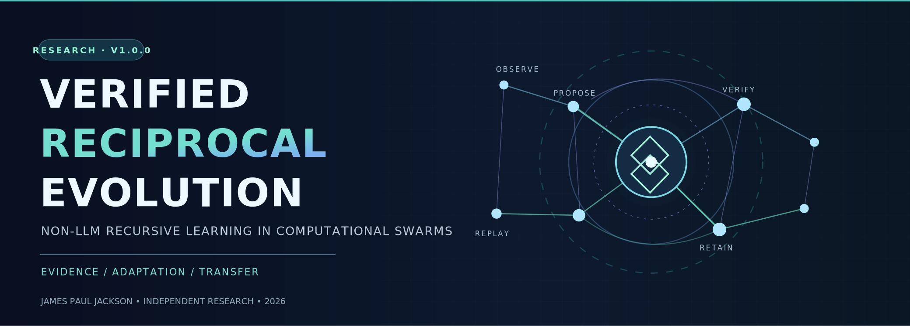
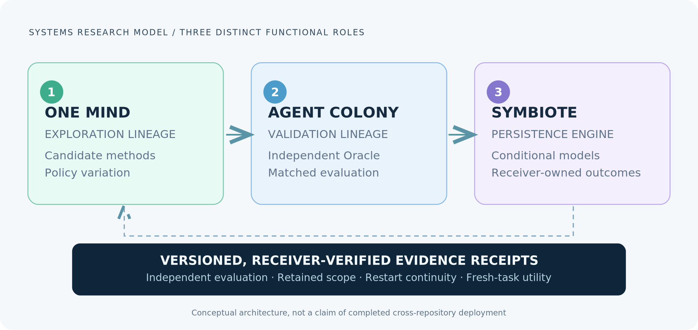

  

# Verified Reciprocal Evolution

*A Framework for Non-LLM Recursive Learning in Computational Swarms*

**James Paul Jackson** · Independent Researcher

**[Read the PDF](paper/Verified_Reciprocal_Evolution.pdf)** · [Word manuscript](paper/Verified_Reciprocal_Evolution.docx) · [Markdown manuscript](paper/Verified_Reciprocal_Evolution.md) · [Research status](RESEARCH_STATUS.md) · [Citation](CITATION.cff)

Can a population of computational specialists learn useful methods without a pretrained language model, retain those methods, and transfer them to an independent system that verifies their value for itself?

Verified Reciprocal Evolution (VRE) develops a framework for investigating that question. It connects bounded search, persistent evidence, recursive policy adaptation, and receiver-owned evaluation. Its central discipline is to measure what changes on fresh tasks: successful checks, accumulated activity, and delivered artifacts do not by themselves demonstrate improved generalization.

> **Research status:** A framework and preliminary-results white paper. Selected mechanisms are implemented, and bounded persistent conditional learning is demonstrated in the cited project records. Causal swarm advantage, broad generalization, and positive bilateral transfer benefit remain unproven. No independent academic peer review is claimed.

## Research overview

VRE distinguishes three capabilities with progressively stronger evidence requirements:

| Capability | Required evidence |
|:--|:--|
| **Persistent learning** | Retained experience changes behavior after a clean restart. |
| **Recursive policy adaptation** | Results alter future policies, with their effects measured on later tasks. |
| **Reciprocal transfer** | An independent receiver validates imported evidence and demonstrates a benefit on its own tasks. |

The proposed contribution is an integrated architecture and evaluation discipline, grounded in existing implementations and their negative results. It builds on digital evolution, cooperative coevolution, classifier systems, swarm intelligence, and automated scientific discovery. It does not claim a new universal optimization theorem.

## Architecture

This is a proposed research architecture, not a claim that the illustrated systems form a fully integrated deployed product. Specialists propose candidates; independent checks qualify evidence; bounded updates change policies; and receivers judge imported artifacts using their own evaluators. Provenance, scope, failures, and resource costs must survive each step.

## Mathematical foundations

The manuscript defines an engineering model and quantities for prospective evaluation. Independently verified quality $Q$, measured cost $C$, and harmful outcomes $H$ contribute to a declared utility:

$$
U(\theta,x)=Q(\theta,x)-\lambda C(\theta,x)-\kappa H(\theta,x).
$$

Cost units and weights must be fixed before evaluation. Learning is assessed on fresh tasks by comparing the updated and baseline policies. For reciprocal exchange, each directional effect includes the receiver's benefit and declared exchange and verification costs. The weaker direction determines the bilateral test:

$$
\mathcal B=\min(\Delta_{A\rightarrow B},\Delta_{B\rightarrow A}).
$$

Positive $\mathcal B$ is a proposed test target, not an established result. The [manuscript](paper/Verified_Reciprocal_Evolution.md) also specifies admissible updates, communication interventions, and hard correctness constraints.

## What the evidence demonstrates

| System | Historical observation | Scientific boundary |
|:--|:--|:--|
| **Agent Colony** | A working computational society with specialists, an Oracle, Hive/Bitwork routing, self-change trials, and a paired control. | Architecture and activity do not establish general intelligence. |
| **Agent Colony holdout** | Learning-on averaged **4.0** verified cases per seed versus **1.6** learning-off. Harmful keeps averaged **0.4** versus **0.2**. | The safety-constrained criterion failed. The newer and prior versions produced identical paired results. |
| **One Mind** | An experimental policy fork with a lower acceptance threshold and a relaxed keep rule. | Independent superiority over Agent Colony has not been established. |
| **SYMBIOTE fresh use** | **128** correct case/input predictions after restart, across four bounded cases. | The isolated structural learner tied. This experiment did not transfer peer artifacts. |
| **SYMBIOTE receiver feedback** | A separate scenario recorded receiver-owned evaluation, adoption, and actual retained-case use. | Fresh-task transfer advantage and strict reciprocal economic benefit remain unproven. |

The [claims register](reproducibility/CLAIMS_AND_EVIDENCE.md) traces results to frozen evidence. The [research status](RESEARCH_STATUS.md) preserves failed criteria, ties, and qualification limits.

## Systems and source snapshots

All reported observations refer to historical revisions, not live counters.

| System | Role | Cited snapshot |
|:--|:--|:--|
| [Agent Colony](https://github.com/jacksonjp0311-gif/agent-colony) | Computational swarm and controlled adaptation | [4304c25d78da](https://github.com/jacksonjp0311-gif/agent-colony/tree/4304c25d78dab105f78cfbb9c97bf665e793bbf5) |
| [One Mind](https://github.com/jacksonjp0311-gif/one-mind) | Experimental evolutionary policy fork | [4cb56b27eacd](https://github.com/jacksonjp0311-gif/one-mind/tree/4cb56b27eacd7640e3c931f5625aadf9db4fd1f6) |
| [SYMBIOTE](https://github.com/jacksonjp0311-gif/SYMBIOTE) | Persistent structural learning and receiver evaluation | [482bf104c897](https://github.com/jacksonjp0311-gif/SYMBIOTE/tree/482bf104c89721965ec006cc9f5b9f37237278bd) |
| [NOMAD](https://github.com/jacksonjp0311-gif/NOMAD) | Program construction and constrained execution | [58515665dccc](https://github.com/jacksonjp0311-gif/NOMAD/tree/58515665dcccfdaa1c046907b51189a19e48c5aa) |
| [Adaptive Agents](https://github.com/jacksonjp0311-gif/adaptive-agents) | Specialist identity and evidence retention | [1dc6b1e15bcc](https://github.com/jacksonjp0311-gif/adaptive-agents/tree/1dc6b1e15bccb3d3c29823f86796d735ad120aef) |
| [PEGASUS](https://github.com/jacksonjp0311-gif/PEGASUS) | Orchestration, continuity, and verification infrastructure | [d920bd2e6cb8](https://github.com/jacksonjp0311-gif/PEGASUS/tree/d920bd2e6cb8d300309cebfb319e0c9cd2944f08) |

The supporting systems are implementation context, not additional independent success samples.

## Reproducibility and roadmap

Start with the [claims register](reproducibility/CLAIMS_AND_EVIDENCE.md), [bibliography](references/REFERENCES.bib), and [prospective protocols](reproducibility/PROTOCOL.md). The planned studies test:

1. Retained experience against matched learning-off and simple deterministic baselines.
2. Communication against silent, shuffled-message, and evidence-only controls.
3. Receiver-owned transfer against equal-budget isolated learning in both directions.
4. Executable method composition and reuse on fresh tasks.

These protocols are proposals, not experiments completed for this publication. Preserve original registrations and report re-exposed holdouts as reused data.

The [editorial audit](EDITORIAL_AUDIT.md) records publication corrections and review limits. [Source provenance](reproducibility/SOURCE_PROVENANCE.json) and the [publication hash manifest](reproducibility/PUBLICATION_MANIFEST.sha256) support file-integrity checks; hashes do not certify scientific claims.

## Citation

Jackson, James Paul. (2026). *Verified Reciprocal Evolution: A Framework for Non-LLM Recursive Learning in Computational Swarms*. Independent research white paper. [Canonical repository](https://github.com/jacksonjp0311-gif/verified-reciprocal-evolution).

Use [CITATION.cff](CITATION.cff) for reference-manager metadata and include the specific commit consulted when reproducibility matters. No DOI has been assigned.

## License and attribution

© 2026 James Paul Jackson. The original manuscript, publication graphics, and original documentation are licensed under **[CC BY 4.0](LICENSE)**. Attribute the author, link the license, and indicate changes.

Cited publications and linked software repositories retain their own rights and licenses. This publication repository includes no executable software implementation.

