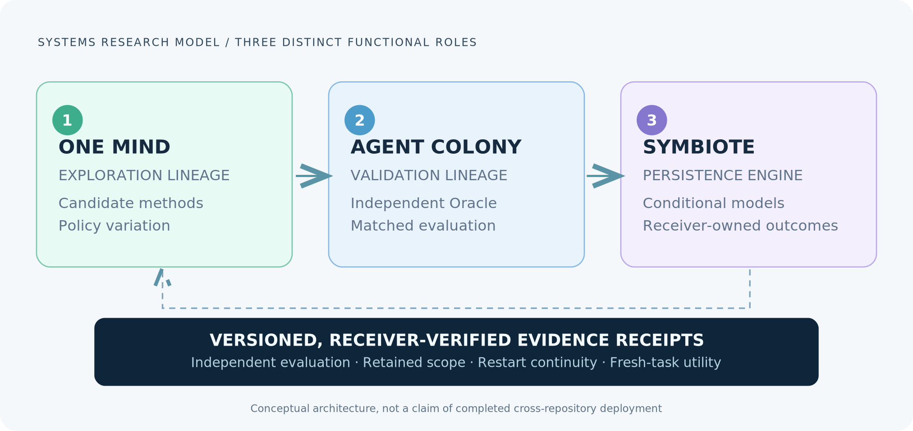
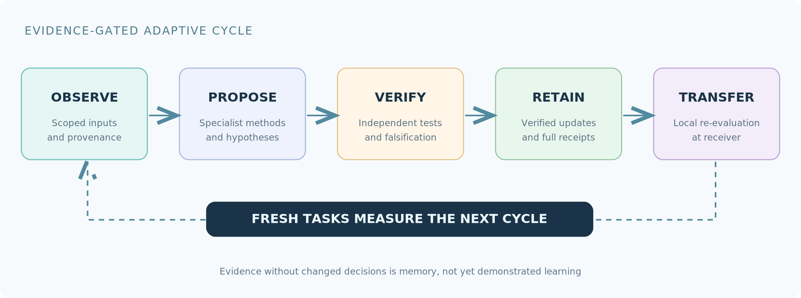

# Verified Reciprocal Evolution

*A Framework for Non-LLM Recursive Learning in Computational Swarms*

**James Paul Jackson | Independent Researcher**

16 November 2026 | Release 1.0.0

> **RESEARCH STATUS | Version 1.0.0** — Architecture and experimental-methodology paper with preliminary implementation evidence. The framework and measurement equations are proposed contributions. Demonstrated scoped learning does **not** establish general intelligence, universal transfer, or a reciprocal efficiency advantage. No independent peer review is claimed.



**Abstract.** Contemporary agent systems are frequently defined by their coordination of pretrained language models. In contrast, an alternative research program asks whether interacting, non-linguistic or deterministic computational specialists can acquire useful behavior through evidence, search, adaptation, persistent state, and reciprocal knowledge exchange. We present *Verified Reciprocal Evolution* (VRE), a framework that distinguishes three progressively stronger capabilities: persistent conditional learning, recursive policy adaptation, and receiver-verified cross-system transfer. The framework is grounded in a source-level examination of three implemented systems: Agent Colony, a scripted computational society with an Oracle, Hive/Bitwork routing, a twin control, and self-modification trials; One Mind, a permissive experimental policy fork; and SYMBIOTE, a Rust-native learning engine with verified persistence and receiver-owned adoption. Existing observations establish bounded behavior changes and conditional fresh-input prediction. In a registered SYMBIOTE experiment, restarted learned models correctly predicted 128 case/input pairs, yet tied an isolated structural learner. Agent Colony's preregistered holdout reported increased within-run coverage relative to a learning-off control but failed its safety-constrained learning criterion and showed no gain between successive software versions. We formalize evidence-qualified updates, causal communication benefit, and the net utility of reciprocal transfer, then specify preregistered ablations that could falsify the claimed advantages. VRE is offered as a reproducible research architecture and set of open hypotheses, not as proof of general intelligence or superior learning efficiency.

**Keywords.** computational swarms; non-LLM learning; recursive policy adaptation; digital evolution; evidence provenance; prospective evaluation; receiver-owned transfer.


## 1. Introduction

The dominance of large language models in current agent engineering can obscure a broader computational question: *Must a learning computational society derive its adaptive capacity from a pretrained language model?* A system can instead alter its future behavior through discrete algorithms, persistent observations, verified hypotheses, search policies, and feedback. Such a system need not generate natural language fluently. Its intelligence claim must be assessed through what it can learn, verify, retain, and transfer under controlled conditions.

This is not a novel observation in isolation. Digital evolution, learning classifier systems, reinforcement learning, self-adaptive computing, cooperative coevolution, and automated scientific discovery already explore forms of adaptive computation without dependence on LLMs [1–7]. The research problem addressed here is more specific: how to compose multiple independently acting computational specialists into an experimental system where *evidence*, rather than agent agreement or unverified rewards, determines what survives adaptation and moves between computational lineages.

We introduce **Verified Reciprocal Evolution (VRE)** as a reference architecture and measurement discipline for that problem. It uses an explicitly non-LLM learning core and treats external language models, if present in a host environment, as optional interfaces rather than as the source of the core learning mechanism. VRE distinguishes an observation from a verified result; a remembered result from an effective policy change; and a delivered artifact from a demonstrated benefit to its receiver.

The work has four contributions. First, it gives an operational taxonomy of persistent learning, recursive adaptation, and transferable collective learning. Second, it specifies a common state and evidence model capable of representing a computational swarm and its external exchange partners. Third, it audits a real implementation family against reproducible measurements, including negative findings. Fourth, it proposes a falsifiable experimental program with explicit baseline, budget, independence, and safety criteria.

The contribution should not be interpreted as discovery of a new optimization theorem, autonomous general intelligence, or a state-of-the-art benchmark result. Its present value is a structured, implementable systems-research argument that can be evaluated and improved by other researchers.

## 2. Terminology, boundaries, and claim taxonomy

**Non-LLM learning system.** The mechanism selecting actions, forming hypotheses, applying updates, and recalling retained experience does not require inference from a pretrained language model. The system may use ordinary software tools, databases, executable domain solvers, and network data sources. This definition does not imply that its learning is unrestricted or that every possible tool is itself free of machine learning.

**Computational specialist.** A bounded executable process or policy that observes a specified input, produces a structured candidate action or finding, and emits evidence about the result. A named persona is not by itself evidence of independent reasoning.

**Computational swarm.** An interacting population of specialists with a shared or connected task objective, observable inter-specialist influence, and a collective decision mechanism. Message counts alone do not prove swarm-level advantage; causal contribution must be tested.

**Persistent learning (L1).** An evaluated observation changes a stored model or usable policy such that a restarted system performs a task differently without reacquiring the original evidence.

**Recursive policy adaptation (L2).** Results from the system's own attempts affect the selection or structure of future computational policies. The changed policy must be measured on later tasks to distinguish learning from state churn.

**Reciprocal transfer (L3).** Evidence produced by one independent system becomes an *informative prior* for a second system; the receiver independently validates the candidate and demonstrates a benefit on its own tasks. Bidirectional benefit requires both directions to pass their own tests.

**Verified knowledge.** An observation whose provenance, task scope, evaluation procedure, and result are independently auditable. A correct-looking numeric output or matching hash alone is not sufficient proof that a claim is universally valid.

| Claim category | Minimum evidentiary standard | Permitted interpretation |
|:--|:--|:--|
| Mechanism exists | Executable implementation and passing targeted tests | Implemented software behavior |
| Persistent learning | Frozen training, clean restart, fresh-input evaluation | Bounded retained capability |
| Adaptive advantage | Matched learning-on/off arms, fresh tasks, cost control | Domain-specific causal improvement |
| Swarm advantage | Communication ablation and independent outcome checks | Benefit of collective interaction |
| Reciprocal advantage | Receiver-owned evaluation and positive net transfer utility | Verified cross-system benefit |
| General capability | Broad independent task families and repeated replications | Stronger generalization claim, if established |

These categories are cumulative but not interchangeable. A correct persistent prediction is not automatically evidence of learning efficiency; a higher fitness proxy is not proof of generalization; and exchanging a file is not proof of symbiosis.

## 3. Relation to prior work

VRE builds on existing research traditions rather than claiming to replace them. Avida established experimental digital evolution as a controlled environment for changing executable organisms [1]. Potter and De Jong formalized cooperative coevolution of interacting subcomponents [2]. Wilson's XCS investigated accuracy-based selection in learning classifier systems [3]. Lehman and Stanley showed how novelty-driven search can escape limitations of objective-only optimization [4], while Mouret and Clune's MAP-Elites demonstrated a repertoire of diverse high-performing strategies [5]. Those precedents already cover evolutionary learning, population specialization, and diversity maintenance.

Kephart and Chess described autonomic computing through feedback-based self-management [6]. King and colleagues' Robot Scientist Adam provides a strong precedent for automated scientific hypothesis generation and experimentally grounded investigation [7]. Swarm-engineering scholarship addresses verification and validation for coordinated populations [8]. Warnat-Herresthal and colleagues provide a distinct example of decentralized machine learning under the term *Swarm Learning*; that framework shares aspects of distributed coordination but is not the same as non-LLM evidence exchange [9]. Wolpert and Macready's no-free-lunch results constrain any broad assertion that one adaptive search policy dominates all possible task domains [10].

The proposed differentiator is **not** a unique algorithmic primitive. It is the coupling of (i) independent domain verification, (ii) provenance-bound persistent experience, (iii) reversible or quarantined self-adaptation, (iv) explicit receiver ownership of imported knowledge, and (v) a causal testing program for transfer. Similar ideas exist separately in prior work; the empirical contribution of their integration remains a question for controlled experiments.

## 4. Implemented systems and evidence sources

The research draws on six public software repositories; three form the primary implementation family. All numerical claims below refer to frozen repository evidence, not a continuously changing GitHub `main` branch. The source manifests in Appendix B identify the applicable revisions.

### 4.1 Agent Colony: scripted computational society

Agent Colony is a Python research society with multiple named specialists, a communication bus, task-specific research modules, append-only witness records, and machine-checkable mathematical claims. Its Oracle and Challenger act as correctness filters. The Hive subsystem uses a deterministic sparse binary feature representation with similarity retrieval, calibration buckets, and constrained action selection. Self-heal can adjust allowed knobs; self-build experiments with bounded structural components. A control arm freezes selected learning mechanisms for paired comparison. Scientific acceptances remain subject to independent checks and the repository's authorization boundary [S1–S3].

The inspected treatment snapshot reports **1,325 completed cycles, 18 active agents, 591 Oracle passes, and 14 self-heal changes kept**. Its paired control scoreboard reports **156 pairs**, with treatment and control at unequal cumulative cycle totals. Verified-depth sums, Oracle passes, and counts beyond published sequence data reflect useful research activity, but their raw cumulative differences cannot be interpreted as causal generalization gains without matched exposure, equal cost, and independent task labels [S1].

The most instructive experiment is the October 16 preregistered holdout v2. Over 12 unseen candidates and five paired seeds, the learning-enabled colony verified **4.0** sound nontrivial candidates per seed on average, versus **1.6** for the learning-off arm. Harmful keeps averaged **0.4** versus **0.2**, so the preregistered condition requiring no safety regression was **not met**. The newer software performed identically to an earlier baseline on the same frozen holdout: **no measurable cross-version capability gain**. The interpretation is narrower: within-run experience improved selection coverage, not reliably safe generalization [S2].

An additional capability limitation is procedural. The colony's published learning report lists **30 research method cards formed but zero tested**, and no verified non-routine proof. It has a documented failure mode in which distant counterexamples escape the available in-loop search range. These are important, explicit limitations rather than reasons to discard the architecture [S1–S3].

### 4.2 One Mind: alternative evolutionary policy regime

One Mind is derived from Agent Colony and intentionally experiments with more permissive update policies. At one inspected snapshot, **180 of 184 Python files in colony/ and hive/ (97.8%) were byte-identical** between the repositories. This makes the pair useful for policy ablations, but it also means their pre-fork evidence and inherited run counts are not statistically independent discoveries [S4].

The fork has used a lower confidence threshold and a less stringent self-change keep rule, while pursuing local and reciprocal feedback and exploration scoring. Source and workflow history also exhibit configuration drift, test failures, and failed state publication. Consequently, this release treats One Mind as an **experimental intervention arm**, not as an empirically validated faster or superior learner. Its independent effects should be measured from a clean fork baseline, with frozen policy settings and a separate results ledger.

### 4.3 SYMBIOTE: native persistent conditional learning

SYMBIOTE is a Rust-native engine that learns conditional structure from authorized observations, independently evaluates received information, and retains accepted behavior across process restarts without language-model inference. The registered width-eight experiment used four cases, each with nine training observations and one separate validation observation. With the source stopped, a restarted learner correctly answered **32 previously unanswered inputs per case, 128 case/input pairs across four cases**. Predictions were committed before evaluation labels were computed [S5–S6].

This supports the claim of **persistent conditional structural learning beyond an answer cache**. It does **not** establish sample-efficiency superiority: an isolated structural learner tied the learned structural arms on these tasks. An optional rank-based mechanism reduced declared finite-field inference work from **28,439 to 713 GF(2) work units per case**, at the cost of retained metadata; the reference and rank variants used the same ten source queries and did not establish whole-system cost reduction. A separate receiver-owned outcome trace demonstrated an evaluated adoption and subsequent use, but strict reciprocal economic benefit remained unproven [S5–S7].

### 4.4 Supporting systems

NOMAD experiments with Bitwork-derived program synthesis and constrained execution; its documented platform snapshot does not establish a learning advantage over simpler controls. Adaptive Agents formalizes ephemeral specialist identity, evaluated evidence, and retention acknowledgement. PEGASUS supplies orchestration, mission continuity, local/cloud execution, and verification infrastructure but is not used here as evidence of an intrinsically non-LLM learning core. These systems supply potential implementation components, not additional independent success samples [S8–S10].

## 5. A formal model of evidence-gated recursive learning

We introduce notation to make experimental claims testable. These equations define an **engineering model and evaluation quantities**, not a mathematical theorem establishing learning or convergence.

Let the internal state of a computational swarm at discrete time $t$ be

$$
S_t = (P_t, M_t, G_t, \theta_t, B_t),
$$

where $P_t$ is the specialist population, $M_t$ its durable and working memory, $G_t$ the evidence-and-communication graph, $\theta_t$ the selectable computational policies, and $B_t$ the available resource budget.

Each specialist $i$ forms an eligible proposal $a_{i,t}$ from its observation $x_t$, local context, and accessible evidence. A selection policy chooses from the set of proposed actions $\mathcal A_t$. The executed action emits a result $y_t$ together with an evidence receipt $e_t$:

$$
(a_t,y_t,e_t) = \operatorname{ExecuteVerify}(S_t,x_t,\mathcal A_t).
$$

An evidence record is $e=(\mathrm{id},\mathrm{source},\mathrm{task},\mathrm{version},\mathrm{method},\mathrm{result},\mathrm{scope},\mathrm{status})$. The `status` field separates observed, conditional, independently verified, refuted, and indeterminate outcomes. Source identity, code digest, task family, evaluator identity, and validity scope must persist when the record is copied or transformed.

The state update is admissible only under a declared evidence rule $\mathcal V$. For a proposed policy $\theta'$, one may define a bounded candidate update

$$
\theta_{t+1} =
\begin{cases}
\theta', & \mathcal V(e_t)=1\ \land\ \mathrm{KeepGate}(\theta',\theta_t)=1,\\
\theta_t, & \text{otherwise}.
\end{cases}
$$

The `KeepGate` must be defined against prospective task performance, not a self-reported improvement estimate. Where a system intentionally runs a permissive exploratory branch, its unverified candidates can remain *experimental* without being reclassified as validated knowledge.

### 5.1 Operational utility and harmful outcomes

Let $Q(\theta,x)$ be independently verified task quality, $C(\theta,x)$ measured compute cost, and $H(\theta,x)$ a penalty for harmful false acceptances. The evaluation utility is

$$
U(\theta,x)=Q(\theta,x)-\lambda C(\theta,x)-\kappa H(\theta,x).
$$

The units and coefficients must be fixed before evaluation; raw counts from different cost regimes must not be pooled as a single unitless gain. A primary experiment may instead use a constrained objective: maximize unique correct results subject to harmful keeps no greater than the control and compute use within the fixed budget.

### 5.2 Transferable improvement

The learning effect on a fresh task distribution $D_{\mathrm{new}}$ is

$$
\Delta_{L} = \mathbb{E}_{x\sim D_{\mathrm{new}}}
\left[U(\theta_{t+1},x)-U(\theta_t,x)\right].
$$

The relevant counterfactual holds the executable substrate and task budget constant while changing only access to learned experience. A changed state alone does not imply $\Delta_L>0$.

### 5.3 Causal contribution of the swarm

Communication may improve coordination, but its value cannot be inferred from message volume. Let $C_{\mathrm{bus}}$ indicate whether inter-specialist messages are available. The causal contribution under matched replay is

$$
\Delta_C=\mathbb E[U\mid do(C_{\mathrm{bus}}=1)]-
\mathbb E[U\mid do(C_{\mathrm{bus}}=0)].
$$

The actual experimental intervention must control shared evidence, message timing, random seeds, compute consumption, and task ordering. An additional shuffled-message control can distinguish informative cooperation from generic activity or increased computation.

### 5.4 Receiver-owned reciprocal benefit

For independent systems $A$ and $B$, let $h_A$ be a candidate artifact from $A$. The receiver $B$ first quarantines the offer, verifies compatibility and task scope using its own evaluator, and decides whether its subsequent policy may use the artifact. The net effect of receiving the artifact is

$$
\Delta_{A\rightarrow B} =
\mathbb E[U_B(\theta_B\oplus h_A,x)-U_B(\theta_B,x)]
-\lambda_B C_{\mathrm{exchange+verify}}.
$$

Here $\oplus$ means *eligible, independently validated adoption*, not simply copying another system's verdict. A sufficient empirical condition for **bilateral benefit in the registered task family** is that both directional gains are independently positive after their declared costs and neither receiver experiences an unacceptable error-rate increase. Define the worst-direction gain as

$$
\mathcal B = \min(\Delta_{A\rightarrow B},\Delta_{B\rightarrow A}).
$$

Positive $\mathcal B$ is a test target, not an established current result. Correctness and resource limits remain hard constraints; a cheaper but incorrect transferred method is not a success.

### 5.5 Diversity versus verification

Alternative strategies may be retained in a quality-diversity archive, as motivated by MAP-Elites [5], with role, cost, behavior, and task-family descriptors. Diversity is not automatically a reward: the system must distinguish a novel candidate from a useful, independently validated capability. The archive may guide exploration without authorizing claims.

## 6. Architecture of the proposed VRE implementation



The architecture separates **exploration**, **validation**, and **retention**. One Mind is an illustrative exploration lineage; Agent Colony is an illustrative controlled-evaluation lineage; SYMBIOTE supplies an example of native retained conditional knowledge and receiver-owned assessment. This is a proposed composition of demonstrably existing modules, not a claim that the three current repositories already form a deployed, fully integrated service.

**Observation and proposal.** Internal sensors and authorized external data create structured tasks. Specialists produce bounded typed proposals. The system can attach diversity pressure or an exploration bonus, but it must record whether a proposed score changed the actual action chosen.

**Independent verification.** The candidate passes through a task-specific oracle or alternate independent checker. Conditional definitions and bounded finite checks retain their scope. An explanation, self-graded score, or consensus vote does not replace a checker.

**Experience and self-adaptation.** Verified outcomes enter content-addressed, append-only records. Mutation operators consume prior successes and failures, but experimental keep decisions must be bound to a single trial identity, code revision, baseline, resource budget, and observed result.

**Exchange and receiver judgment.** A sender exports a versioned inert artifact with evidence references. The receiver verifies source identity, scope, and compatibility, then evaluates its own outcome. Adoption, use, costs, and subsequent benefit are recorded under receiver ownership. Neither system imports the other's authority.

**Operational control.** Experiments need isolated mutable state and a publication coordinator. Competing CI jobs must not overwrite each other's completed work. The immutable experimental receipt is the unit of continuation; a Git push is only a publication mechanism.

## 7. Empirical results and their interpretation

The results below come from versioned project records, not from new experiments conducted for this white paper.

| Observation | Recorded result | Supported inference | Excluded inference |
|:--|:--|:--|:--|
| Agent Colony holdout v2 | 4.0 vs 1.6 verified cases per seed, learning on/off; 0.4 vs 0.2 harmful keeps | Within-run experience affects selection | Safety-constrained capability criterion **not** met |
| Agent Colony cross-version v2 | New versus prior version: identical results on all paired seeds | No measured gain on these unseen candidates | Incremental code growth is not generalized learning |
| Agent Colony current state | 1,325 cycles, 18 active roles, 591 Oracle passes | Persistent scheduled research and checking | Cumulative metrics are not causal intelligence evidence |
| SYMBIOTE registered fresh use | 128/128 case/input predictions correct after source shutdown and restart | Conditional structural model reuse beyond answer cache | Not superior to isolated structural learner |
| SYMBIOTE rank optimization | 28,439 vs 713 declared GF(2) inference units per case | Reduced work in scoped inference operation | No proved whole-system cost advantage |
| One Mind fork | Policy changes over nearly identical Python substrate | A useful intervention design | No independent transfer gain yet |

The apparent success of a more permissive exploratory policy must be judged against false acceptances and opportunity cost. One Mind's tests and publication workflows have encountered failures; these are experimental-validity risks rather than evidence of adaptive progress. Its source proximity to the colony also means that run counts copied at fork time do not create independent replications [S4].

The SWARM hypothesis is currently weaker than the persistence claim. Agent Colony contains extensive communication traffic and a swarm voting procedure, but a causal communication-enabled versus communication-disabled comparison has not yet established additional correctness or transfer. The counterexample and reward-provenance issues identified in the repository must be resolved before treating high-level fitness metrics as scientific evidence.

## 8. Experimental program: preregistered falsifiable studies

A release should distinguish exploratory engineering tests from confirmatory experiments. The experiments below are **protocol proposals**; they are not reported here as completed. Shared task families and repeated random seeds must be clustered appropriately and not counted as independent samples of a wider population.

### E1. Does retained experience improve fresh-task performance?

**Arms.** (A) full learning enabled, (B) identical system with learned experience frozen, (C) randomized or time-shuffled memory, and (D) a minimal deterministic retry-avoidance baseline. Use the same task generator, frozen source revision, resources, random seed schedules, and independent evaluator for every arm. If preexisting training material differs between arms, report it as a limitation.

**Outcomes.** Primary: paired difference in unique sound nontrivial results under a fixed budget. Safety: harmful keeps must not exceed the frozen control under the preregistered rule. Secondary: CPU seconds per correct result, repeat attempts, verified search depth, and unrecoverable errors.

**Evidence threshold.** For the existing Agent Colony v3 holdout, use its already frozen 24-candidate, ten-paired-seed and sign-flip protocol exactly as registered [S3]; do not change its criterion after viewing labels. Any later, broader study must register fresh families and thresholds independently.

### E2. Does specialist communication confer causal value?

**Arms.** Identical population with (A) normal bus, (B) bus disabled, (C) time-shuffled or recipient-shuffled messages, and (D) evidence-only broadcast without independent proposals. All arms receive the same authorized external data, initial memory, and total CPU/wall-time budget.

**Outcomes.** Pairwise independently correct discoveries, harmful keeps, cost, and whether an individual message identifier can be causally linked to a changed plan and a better verified result. Counts of posts, replies, or positive phrases are secondary descriptive metrics.

**Failure condition.** If bus-enabled operation matches or trails the matched evidence-only or silent control, the claimed collective benefit is not demonstrated for that task family.

### E3. Does reciprocal transfer benefit independent receivers?

**Arms.** Within each receiving system, compare local-only learning, equal-budget local exploration, inert foreign information, and independently validated foreign evidence. Include mismatched or misleading artifacts, duplicate deliveries, process restarts, network failure, and explicit rejection. Use at least two independent receiver identities and task families with separately generated final tests.

**Outcomes.** Correctness, independently validated receiver adoption, post-adoption use, fresh-task utility, full exchange and verification cost, retained benefit after restart, and both directional effects $\Delta_{A\to B}$ and $\Delta_{B\to A}$. A zero- or negative-benefit partner cannot be omitted from the bilateral analysis.

**Failure condition.** Receiving a record, agreeing with it, retaining it, or showing a sender-side score increase without a receiver-side causal benefit is not counted as reciprocal learning.

### E4. Does a swarm construct transferable computational methods?

**Arms.** (A) bounded composition of preverified typed operators, (B) best single available operator, (C) randomized operator composition, and (D) a deterministic non-adaptive baseline. Generate training and final tasks from disjoint families where possible.

**Outcomes.** Independently checked correctness, compositional novelty relative to the stored library, use of the constructed method on a second task, resource cost, and rate of invalid compositions. Declaring a method `oracle_compatible` without executing and checking it never counts as a verified solution.

**Failure condition.** If composed methods cannot outperform the best single primitive on unseen tasks without increasing invalid results, the transfer hypothesis remains unproven.

### 8.5 Statistical analysis and release gates

Use paired analyses within identical tasks and seeds, report confidence intervals and exact or permutation tests where justified, and cluster by independently generated task families. Report all arms and failures, not only winning candidates. Multiple exploratory comparisons should be labeled exploratory or adjusted for multiplicity. No new claim of cross-domain generalization is warranted from only one related finite task family.

Each result must provide a preregistration hash, complete frozen code and dependency manifest, task-set commitment, independently evaluated outputs, measurement units, run IDs, and an exposure log. Publishing failure records is a feature of the methodology, not a defect to conceal.

## 9. Engineering invariants and failure analysis

The framework depends on properties that should be checked in code rather than left as prose. The following are requirements for a credible *future implementation*, not all certified properties of the present systems.

**I1 — Provenance preservation.** A conditional or guessed definition cannot become an independently verified statement by passing through a memory or scoring subsystem. Every transformation retains its original evidence scope and source digest.

**I2 — Independent authority.** The receiver's acceptance of an imported candidate must be derived from a locally nominated evaluator and its own observation/replay receipts. A sender-supplied success flag is descriptive, not authoritative.

**I3 — Trial exclusivity and attribution.** Every applied policy change has a unique trial identity, start and end code revisions, and a baseline. Concurrent changes are prohibited in confirmatory windows or explicitly modeled as confounders.

**I4 — Restart and publication continuity.** Accepted experimental events survive interrupted execution and failed version-control publication. Replaying a completed receipt must be idempotent and must not rerun a costly experiment as though it were new evidence.

**I5 — Honest resource accounting.** Costs distinguish source calls, verification, computation, storage, transfer, restart, and supervision. Arbitrary unlike units cannot be added to manufacture an efficiency advantage.

**I6 — Scope-aware claims.** A finite numerical hold, a fully certified bounded proof, and a universal mathematical theorem have different epistemic statuses; none may silently promote into another.

The live implementation audit identifies threats to these invariants: source changes during self-build trials, provenance loss from conditional OEIS definitions, stale in-memory hunter state, inconsistent experiment reservation histories, changing CI snapshots, and nonload-bearing tool facades. Fixing these is prerequisite engineering work for confirmatory evaluation, not an optional cosmetic improvement.

## 10. Discussion: what would count as a distinctive result?

The observation that a computer can learn without a language model is long established [1–3]. Nor is swarm coordination, evolutionary optimization, or autonomous experimental science novel by itself [2,5–9]. The distinctive possible result would be evidence that **a population of bounded, independently verifiable computational specialists builds and transfers useful methods through accumulated observations at a measurable benefit over comparably resourced non-swarm and non-transfer controls**.

Such a result would support a *task-family-specific* form of computational collective learning. It would not automatically show open-ended intelligence, consciousness, self-directed goals, or a universal advantage across unrelated tasks. The no-free-lunch perspective cautions that demonstrated superiority depends on the task distribution and comparator chosen [10]. More permissive mutation can increase exploration while also increasing harmful adoption. Stable architecture should therefore be evaluated both for productive discovery and for false-positive control.

A particularly useful design decision is to keep exploratory and validation lineages separate. An experiment may permit speculative mutations and weak provisional thresholds, whereas the receiver of a result can insist on independent verification before it becomes reusable evidence. This separation resembles an engineering division between search and adjudication, not a biological assertion that the systems possess mental states.

There is also a meaningful negative-result publication opportunity. The registered Agent Colony holdout, SYMBIOTE's isolated-learning tie, and incomplete or failed reciprocal protocols demonstrate that architectural complexity is insufficient proof of learning advantage. Reporting those outcomes creates an auditable baseline against which future genuine improvements can be measured.

## 11. Conclusion

Verified Reciprocal Evolution is presented as a framework for studying non-LLM recursive learning through computational specialization, retained evidence, controlled self-adaptation, and receiver-owned reciprocal evaluation. Existing implementations establish the viability of its constituent mechanisms and, in SYMBIOTE, a scoped retained conditional learning capability. They do not yet establish a general cross-domain learning advantage, a causal benefit from swarm communication, or bilateral economic value from knowledge transfer.

The research program is therefore precise: show that verified experience changes future decisions, show that those decisions improve independent tasks under matched budgets, and show that such improvements survive receipt-based exchange without inheriting another system's authority. If these experiments succeed, they will support a defensible claim of evidence-mediated collective computational learning. If they fail, the negative evidence will be equally important in refining the architecture.

**Release status.** Version 1.0.0 is a publication-ready *framework and preliminary-results manuscript*. It is not an experimentally qualified claim of broad recursive general intelligence or reciprocal superiority.

## Appendix A. Reference adaptation cycle (normative pseudocode)

```text
INPUT: task x, swarm state S, budget B
1. Observe x; retrieve scoped prior evidence and its provenance.
2. Specialists independently propose typed actions or methods.
3. Select at most the valid number of actions allowed by B.
4. Execute in a bounded, version-pinned trial; save immutable receipts.
5. Verify results with a task-independent or held-out evaluator.
6. Classify evidence as verified, conditional, refuted, or unknown.
7. Update exploratory priors; apply durable policy changes only after
   the declared keep gate and non-regression criteria pass.
8. Preserve trial outcome and rollback information across restart.
9. If exporting: send inert evidence with version, source, and scope.
10. Receiver independently evaluates, measures cost and fresh use,
    and records adoption or rejection under its own identity.
OUTPUT: updated state, audit records, and qualified claim status
```

The pseudocode intentionally separates *candidate exploration* from *durable verified knowledge*; systems with more permissive local adaptation may still produce only candidate-grade transferable evidence.

## Appendix B. Project evidence and frozen source identifiers

This appendix lists the primary artifacts used to establish historical implementation and experimental facts. Paths and revisions should be preserved in the public release. Values reflect specific artifacts and are not live dashboards.

- **[S1] Agent Colony inspected snapshot.** `jacksonjp0311-gif/agent-colony` at `4304c25d78da` (16 Nov 2026 UTC 17 Nov). Primary files: `society/CI_STATUS.json`, `society/systems/twin_scoreboard.json`, `society/LEARNING.md`, `README.md`. Repository: <https://github.com/jacksonjp0311-gif/agent-colony>.
- **[S2] Agent Colony holdout v2.** `evidence/2026-10-16-holdout-v2/README.md` at the [S1] revision. The run reports no cross-version capability gain and failed safety-constrained learning promotion. <https://github.com/jacksonjp0311-gif/agent-colony/tree/main/evidence/2026-10-16-holdout-v2>.
- **[S3] Agent Colony preregistration.** `evaluation/PREREGISTRATION.md` and `evaluation/EXPOSURES.jsonl`, including the unexposed v3 addendum at the inspected snapshot. <https://github.com/jacksonjp0311-gif/agent-colony/tree/main/evaluation>.
- **[S4] One Mind inspected snapshot.** `jacksonjp0311-gif/one-mind` at `4cb56b27eacd`; README, `colony/learning_loop.py`, `hive/bitwork.py`, `hive/swarm.py`, reciprocal exchange and workflow history. <https://github.com/jacksonjp0311-gif/one-mind>.
- **[S5] SYMBIOTE source snapshot.** `jacksonjp0311-gif/SYMBIOTE` at `482bf104c897` including `docs/ENGINE_EVOLUTION_002.md`. <https://github.com/jacksonjp0311-gif/SYMBIOTE>.
- **[S6] SYMBIOTE registered fresh-input test.** Four width-eight cases, 32 distinct previously unanswered inputs per case, restarted source-free prediction, registered after frozen training. Details in `docs/ENGINE_EVOLUTION_002.md` [S5].
- **[S7] SYMBIOTE limits and historical protocols.** `docs/RESEARCH_V06_PROTOCOL.md`, `docs/RESEARCH_V05_PRIMARY_HOLD.md`, `README.md`. Explicit `NOT_DEMONSTRATED` reciprocal-efficiency claims and incomplete historical cohort evidence.
- **[S8] NOMAD** at `58515665dccc`; `docs/PLATFORM_ARCHITECTURE.md`, `README.md`. <https://github.com/jacksonjp0311-gif/NOMAD>.
- **[S9] Adaptive Agents** at `1dc6b1e15bcc`; `README.md`, `docs/MATHEMATICS.md`. <https://github.com/jacksonjp0311-gif/adaptive-agents>.
- **[S10] PEGASUS** at `d920bd2e6cb8`; `README.md`, `docs/LEARNING-LOOP.md`, `docs/ARCHITECTURE.md`. <https://github.com/jacksonjp0311-gif/PEGASUS>.

## References

[1] C. Ofria and C. O. Wilke, “Avida: A Software Platform for Research in Computational Evolutionary Biology,” *Artificial Life*, vol. 10, no. 2, pp. 191–229, 2004. <https://doi.org/10.1162/106454604773563612>.

[2] M. A. Potter and K. A. De Jong, “Cooperative Coevolution: An Architecture for Evolving Coadapted Subcomponents,” *Evolutionary Computation*, vol. 8, no. 1, pp. 1–29, 2000. <https://doi.org/10.1162/106365600568086>.

[3] S. W. Wilson, “Classifier Fitness Based on Accuracy,” *Evolutionary Computation*, vol. 3, no. 2, pp. 149–175, 1995. <https://doi.org/10.1162/evco.1995.3.2.149>.

[4] J. Lehman and K. O. Stanley, “Abandoning Objectives: Evolution Through the Search for Novelty Alone,” *Evolutionary Computation*, vol. 19, no. 2, pp. 189–223, 2011. <https://doi.org/10.1162/EVCO_a_00025>.

[5] J.-B. Mouret and J. Clune, “Illuminating Search Spaces by Mapping Elites,” arXiv:1504.04909, 2015. <https://arxiv.org/abs/1504.04909>.

[6] J. O. Kephart and D. M. Chess, “The Vision of Autonomic Computing,” *Computer*, vol. 36, no. 1, pp. 41–50, 2003. <https://doi.org/10.1109/MC.2003.1160055>.

[7] R. D. King et al., “The Automation of Science,” *Science*, vol. 324, no. 5923, pp. 85–89, 2009. <https://doi.org/10.1126/science.1165620>.

[8] M. Brambilla, E. Ferrante, M. Birattari, and M. Dorigo, “Swarm Robotics: A Review from the Swarm Engineering Perspective,” *Swarm Intelligence*, vol. 7, pp. 1–41, 2013. <https://doi.org/10.1007/s11721-012-0075-2>.

[9] S. Warnat-Herresthal et al., “Swarm Learning for Decentralized and Confidential Clinical Machine Learning,” *Nature*, vol. 594, pp. 265–270, 2021. <https://doi.org/10.1038/s41586-021-03583-3>.

[10] D. H. Wolpert and W. G. Macready, “No Free Lunch Theorems for Optimization,” *IEEE Transactions on Evolutionary Computation*, vol. 1, no. 1, pp. 67–82, 1997. <https://doi.org/10.1109/4235.585893>.

---

**Citation suggestion.** Jackson, J. P. (2026). *Verified Reciprocal Evolution: A Framework for Non-LLM Recursive Learning in Computational Swarms* (Version 1.0.0). Independent research white paper. No DOI assigned. Cite the specific release commit once published.

**Rights.** © 2026 James Paul Jackson. Manuscript and original graphics released under Creative Commons Attribution 4.0 International (CC BY 4.0). Third-party cited research retains its own rights. The publication does not imply affiliation with the cited institutions or journals.
